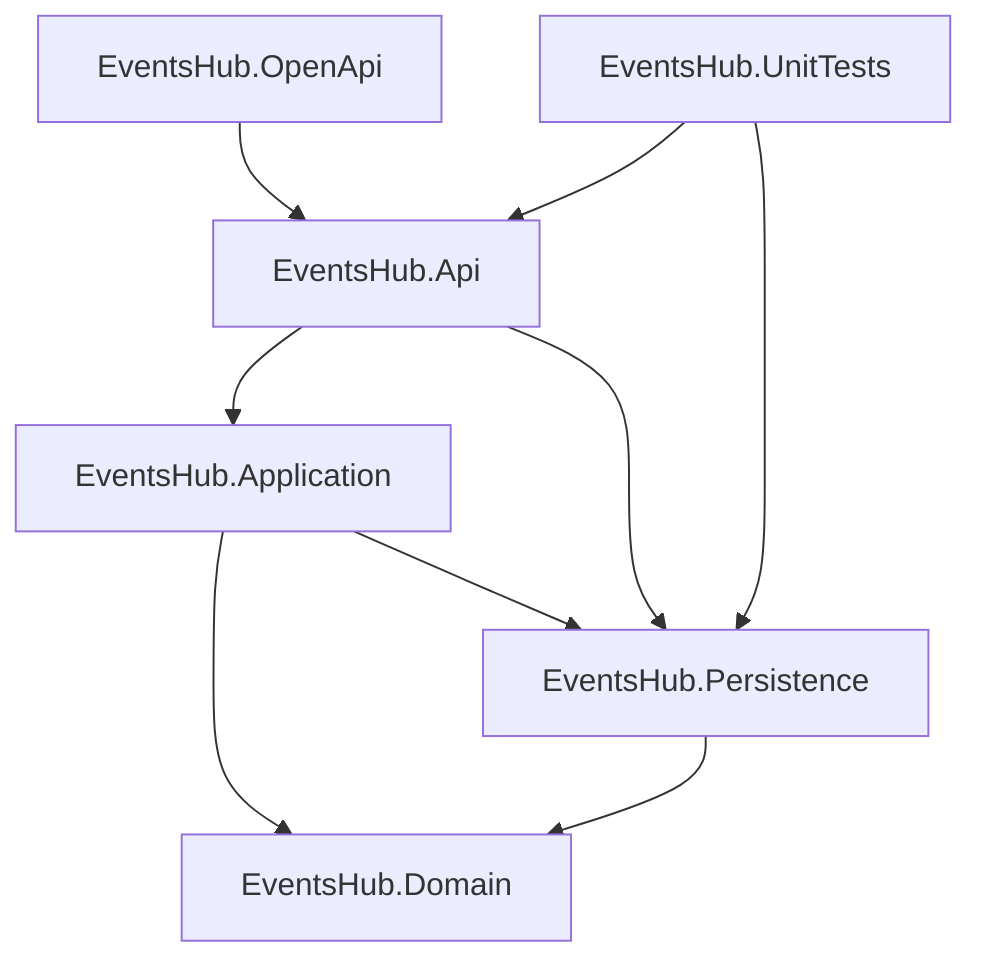
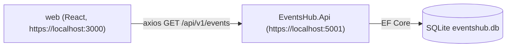

# EventsHub

ICI 2026 01

EventsHub es una aplicación para consultar eventos (culturales, musicales, de bebidas, etc.) en distintas ciudades de México. Tiene una API REST en ASP.NET Core con base de datos SQLite y un frontend en React que consume esa API.

## Tecnologías

| Capa | Tecnología | Versión |
|---|---|---|
| Backend | .NET / ASP.NET Core | `net10.0` |
| ORM | Entity Framework Core (SQLite) | 10.0.11 |
| Documentación API | NSwag (`NSwag.AspNetCore`, `nswag.consolecore`) | 14.7.1 |
| Pruebas unitarias | NUnit / NUnit3TestAdapter | 4.3.2 / 5.0.0 |
| Pruebas de integración | Bruno (colección OpenCollection YAML) | — |
| Frontend | React / React DOM | ^19.2.8 |
| UI | MUI (`@mui/material`, `@mui/icons-material`) + Roboto | ^9.5.0 |
| HTTP | axios | ^1.20.0 |
| Build | Vite + React Compiler (Babel) | ^8.3.0 |
| Lenguaje | TypeScript | ~6.0.2 |
| Lint | ESLint / typescript-eslint | ^10.10.0 / ^8.69.0 |

## Estructura del repositorio

```text
EventsHub/
├── EventsHub.slnx                  # Solución .NET
├── restart-api.ps1 / stop-api.ps1  # Scripts para levantar/detener la API
├── docs/OpenApi 1.md               # Guía completa de OpenAPI + cliente NSwag
├── src/
│   ├── EventsHub.Domain/           # Entidades (Event)
│   ├── EventsHub.Persistence/      # AppDbContext, datos semilla y migraciones
│   ├── EventsHubApplication/       # Proyecto EventsHub.Application (vacío por ahora)
│   ├── EventsHub.Api/              # API REST (controllers, Program.cs, eventshub.db)
│   ├── EventsHub.OpenApi/          # Host que solo genera el documento OpenAPI
│   ├── nswag/EventsHub.nswag       # Configuración de generación del cliente C#
│   └── openapi/EventsHub.v1.json   # Documento OpenAPI generado
├── tests/
│   ├── EventsHub.UnitTests/        # Pruebas NUnit
│   └── EventHub.integrationTests/  # Colección Bruno
└── web/                            # Frontend React + Vite
```

## Arquitectura

El backend está dividido en capas:

- **Domain**: entidades sin dependencias externas. Hoy solo existe `Event`.
- **Persistence**: `AppDbContext` de EF Core, `DbInitializer` (datos semilla) y migraciones.
- **Application**: reservado para la lógica de negocio. Todavía no tiene código.
- **Api**: controllers ASP.NET Core. Todos heredan de `EventsHubBaseController`, que aplica `[ApiController]` y la ruta `api/v1/[controller]`. Por ahora los controllers usan `AppDbContext` directamente.
- **OpenApi**: aplicación aparte que carga los controllers de Api solo para generar el documento Swagger. No es la API que se ejecuta.



Flujo en tiempo de ejecución:



La API devuelve JSON en camelCase (`title`, `isCancelled`…), aunque en C# las propiedades están en PascalCase. Los tipos del frontend en [web/src/lib/Types/index.d.ts](web/src/lib/Types/index.d.ts) siguen la forma camelCase.

## Requisitos previos

- [.NET SDK 10](https://dotnet.microsoft.com/download). Probado con 10.0.401.
- Node.js y npm. Probado con Node v24.19.0; la versión mínima está **Pendiente**.
- Herramienta global `dotnet-ef`, solo para crear migraciones: `dotnet tool install --global dotnet-ef`. No está en el manifiesto `.config/dotnet-tools.json`, así que la versión recomendada está **Pendiente** (debería coincidir con EF Core 10.0.11).
- Certificado HTTPS de desarrollo de .NET: `dotnet dev-certs https --trust`
- El frontend usa `vite-plugin-mkcert`, que genera un certificado local la primera vez que se ejecuta `npm run dev`.
- [Bruno](https://www.usebruno.com/), opcional, para las pruebas de integración.
- NSwag (`nswag.consolecore` 14.7.1) se instala como herramienta local con `dotnet tool restore`.

## Puesta en marcha

### Backend

```powershell
dotnet restore
.\restart-api.ps1
```

`restart-api.ps1` detiene los procesos `dotnet`/`MSBuild` que se hayan quedado abiertos y luego ejecuta `dotnet watch` en `src/EventsHub.Api`. Opciones:

| Comando | Efecto |
|---|---|
| `.\restart-api.ps1` | Reinicia la API y conserva los datos |
| `.\restart-api.ps1 -Reset` | Borra `eventshub.db` para que se vuelvan a sembrar los datos (con IDs nuevos) |
| `.\restart-api.ps1 -Reset -Clean` | Además ejecuta `dotnet clean` |

También se puede levantar sin el script:

```powershell
cd src/EventsHub.Api
dotnet watch   # o: dotnet run
```

La API queda en **https://localhost:5001** (perfil `https` de [launchSettings.json](src/EventsHub.Api/Properties/launchSettings.json)).

### Frontend

1. Crea `web/.env`. Está en `.gitignore`, así que cada quien debe crear el suyo:

   ```bash
   VITE_API_URL=https://localhost:5001/api/v1
   ```

2. Instala dependencias y levanta Vite:

   ```powershell
   cd web
   npm install
   npm run dev
   ```

El frontend queda en **https://localhost:3000**. La política CORS de la API solo acepta `http://localhost:3000` y `https://localhost:3000`, así que no hay que cambiar ese puerto.

Otros scripts de `web/`: `npm run build` (`tsc -b && vite build`), `npm run lint` y `npm run preview`.

## Base de datos

- **Motor:** SQLite. La cadena de conexión `SqliteConnection` en [appsettings.json](src/EventsHub.Api/appsettings.json) es `Data Source=eventshub.db`, y el archivo se crea en `src/EventsHub.Api/`.
- **Migraciones automáticas:** al iniciar, `Program.cs` ejecuta `Database.MigrateAsync()` y luego `DbInitializer.SeedData()`.
- **Datos semilla:** son 10 eventos, 5 pasados y 5 futuros, con fechas relativas a `DateTime.Now`. Solo se insertan si la tabla `Events` está vacía.
- **Migraciones existentes:** `InitiaCreate` y `PascalCaseEventProperties`.

Para crear una migración nueva:

```powershell
dotnet ef migrations add <NombreMigracion> --project src/EventsHub.Persistence --startup-project src/EventsHub.Api
```

Para reiniciar los datos, usa `.\restart-api.ps1 -Reset`.

## API

Base: `https://localhost:5001/api/v1`

| Método | Ruta | Descripción | Respuestas |
|---|---|---|---|
| GET | `/events` | Lista todos los eventos | 200 `Event[]` |
| GET | `/events/{id}` | Devuelve el detalle de un evento | 200 `Event`, 404 `"the event was not found"` |
| GET | `/weatherforecast` | Endpoint de ejemplo de la plantilla | 200 `WeatherForecast[]` |

El documento OpenAPI actual no incluye la respuesta 404 de `/events/{id}`.

### Modelo `Event`

| Campo (JSON) | Tipo | Notas |
|---|---|---|
| `id` | string | GUID generado automáticamente |
| `title` | string | requerido |
| `date` | DateTime | |
| `description` | string | requerido |
| `category` | string | requerido (`culture`, `music`, `drinks` en los datos semilla) |
| `isCancelled` | bool | |
| `city` | string | requerido |
| `venue` | string | requerido |
| `latitude` | string | requerido |
| `longitude` | string | requerido |

## OpenAPI y cliente generado

La guía completa está en [docs/OpenApi 1.md](docs/OpenApi%201.md). Resumen, ejecutando todo desde la raíz:

```powershell
# 1. Levantar el host de documentación
dotnet run --project src/EventsHub.OpenApi/EventsHub.OpenApi.csproj --no-launch-profile --urls http://127.0.0.1:5011

# 2. (otra terminal) Descargar el documento
Invoke-WebRequest -Uri http://127.0.0.1:5011/swagger/EventsHub/swagger.json -OutFile src/openapi/EventsHub.v1.json

# 3. Detener el host
Get-Process -Name "EventsHub.OpenApi" | Stop-Process -Force

# 4. Generar el cliente C#
dotnet tool restore
dotnet tool run nswag run src/nswag/EventsHub.nswag
```

Estos archivos son generados y no deben editarse a mano:

- `src/openapi/EventsHub.v1.json`
- `src/src/EventsHub.OpenApi/Generated/EventsHubRpcClient.generated.cs`

El cliente queda en `src/src/...` porque la ruta `output` del `.nswag` se toma relativa a `src/nswag/`. La tabla de rutas al inicio de la guía muestra `nswag/` y `openapi/` en la raíz, pero en este repositorio están dentro de `src/`.

## Pruebas

### Unitarias (NUnit)

```powershell
dotnet test tests/EventsHub.UnitTests

# Una sola prueba
dotnet test tests/EventsHub.UnitTests --filter "FullyQualifiedName~EventsControllerTests.GetEventDetailAsync_WhenEventExists_ReturnsMatchingEvent"
```

[GlobalTestSetup.cs](tests/EventsHub.UnitTests/GlobalTestSetup.cs) crea una base SQLite real (`eventshub.db`) en la carpeta de salida de las pruebas, aplica las migraciones y los datos semilla, y comparte un `AppDbContext` estático. Las pruebas de [EventsControllersTest.cs](tests/EventsHub.UnitTests/controllers/EventsControllersTest.cs) crean `EventsController` directamente con ese contexto.

### Integración (Bruno)

La colección [tests/EventHub.integrationTests](tests/EventHub.integrationTests) se abre en [Bruno](https://www.usebruno.com/) y se ejecuta con el entorno `local` (`baseUrl = https://localhost:5001/api/v1`). La API tiene que estar corriendo. Contiene:

- `Events - List - 200`
- `Events - Get - 200`
- `Events - Get - 404`
- `WeatherForecast - list - 200`

`Events - Get - 200` usa un GUID fijo. Cada vez que la base se vuelve a sembrar (`-Reset`), hay que reemplazarlo por un ID que exista.

## Scripts útiles

| Script | Uso |
|---|---|
| [restart-api.ps1](restart-api.ps1) | Detiene procesos, opcionalmente borra la base (`-Reset`) y limpia la compilación (`-Clean`), y levanta la API con `dotnet watch` |
| [stop-api.ps1](stop-api.ps1) | Detiene todos los procesos `dotnet`/`EventsHub`/`VBCSCompiler`/`MSBuild`. Sirve cuando la compilación falla porque hay archivos bloqueados |

## Convenciones

- **Ramas:** una por entrega (`PARCIAL-01`, `PARCIAL-02`, …). `main` es la rama principal.
- **Commits:** `tipo(PARCIAL-NN) - descripción`, por ejemplo `feat(PARCIAL-02) - add CORS` o `chore(PARCIAL-02) - remove duplicate web/EventsHub template`.

## Estado actual y pendientes

Avance en la rama `PARCIAL-02`: CORS, el frontend con MUI y axios que lista eventos, las propiedades de `Event` en PascalCase y las pruebas unitarias del controller.

Pendientes que se ven en el código:

- `EventsHub.Application` todavía no tiene lógica, y los controllers acceden a `AppDbContext` directamente.
- `WeatherForecastController` y `WeatherForecast` son restos de la plantilla.
- El frontend solo muestra la lista de títulos. `App.tsx` define un tipo `Activity` local en lugar de usar el de `lib/Types`, y `App.css` conserva estilos de la plantilla de Vite.
- En `Program.cs`, `AddCors()` y `UseCors(...)` aparecen dos veces, y queda un bloque vacío `if (app.Environment.IsDevelopment()) { }`.
- En [web/src/lib/Types/index.d.ts](web/src/lib/Types/index.d.ts), `latitude` y `longitude` son `number`, pero la API los devuelve como `string`.
- Solo existen endpoints de lectura (GET).
